# Assignment 3 — Production Maintenance Drill (OPS Checklist)

Part of the DevOps Micro Internship (DMI) with Agentic AI

---

## Purpose

In this assignment, you will treat your already deployed React application (on Ubuntu VM with Nginx) as a live production system. You will perform structured operational checks covering network validation, service health, log analysis, resource monitoring, configuration verification, and incident simulation with recovery — mirroring real on-call DevOps responsibilities.

---

# Task 1 — Server Access & Networking Validation

## Goal

Verify that the deployed React application is reachable from the browser and confirm basic network connectivity of the Ubuntu VM.

### Evidence

#### Screenshot 1 — Browser showing the React app with your Full Name visible on the UI

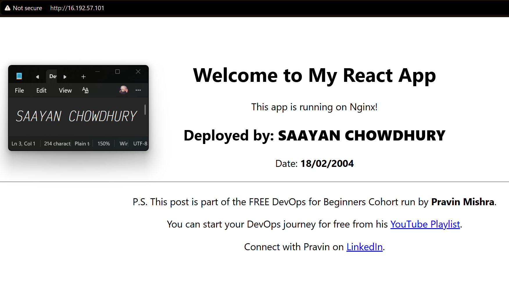

---

#### Screenshot 2 — Output of `ip a`

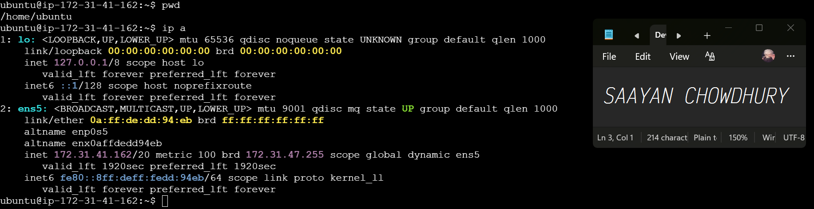

---

#### Screenshot 3 — Output of `sudo ss -tulpen`

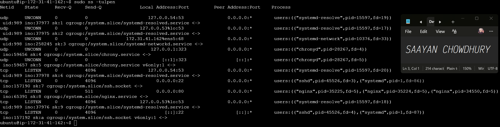

---

#### Screenshot 4 — Output of `sudo ufw status`

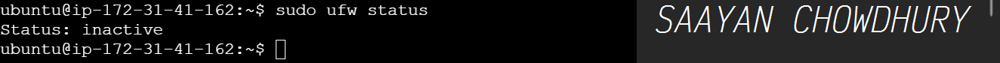

---

### Notes

Answer the following in your own words:

**1. What proves Nginx is listening on 0.0.0.0:80?**

The React application is accessible through the server's public IP address in a browser. This confirms that Nginx is serving HTTP requests on port 80. The ss command can also directly confirm whether Nginx is listening on 0.0.0.0:80.

---

**2. What proves SSH is active on port 22?**

I can confirm that SSH is active by checking the output of sudo ss -tulpen and verifying that the SSH service is listening on port 22. A successful remote SSH connection would also confirm that it is working.

---

**3. Did you find any unexpected open ports? Explain briefly.**

No, I didn't find any unexpected open ports. The open ports were required for services like SSH on port 22 and Nginx on port 80. Keeping only the necessary ports open reduces the server's security risks.

---

# Task 2 — Service Health & Systemd Validation (Nginx)

## Goal

Verify that Nginx is properly installed, running, enabled at boot, and safely configured.

### Evidence

#### Screenshot 1 — Output of `systemctl status nginx --no-pager`

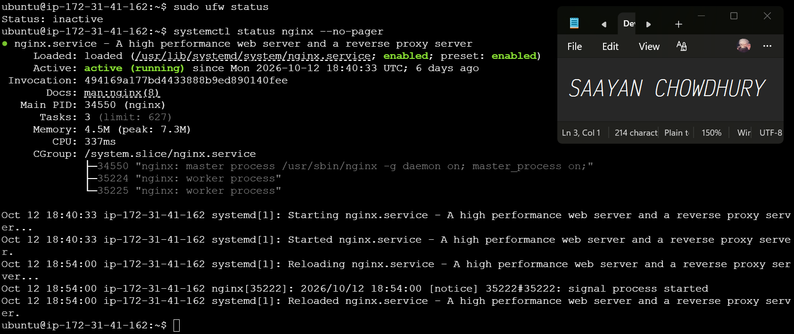

---

#### Screenshot 2 — Output of `sudo nginx -t`

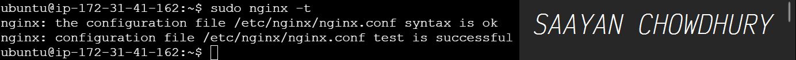

---

#### Screenshot 3 — Output of `sudo ss -lptn '( sport = :80 )'`

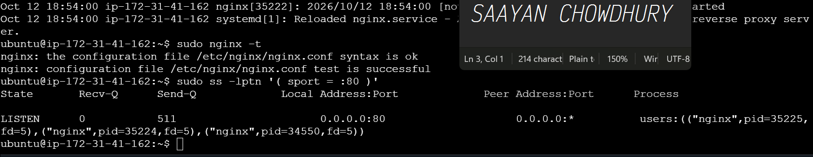

---

### Notes

Answer the following in your own words:

**1. What happens if Nginx fails to restart in production?**

If Nginx fails to restart, the website may become unavailable to users. This can cause downtime and failed requests until the issue is identified and fixed. That's why checking the configuration before restarting the service is important.

---

**2. What's your basic rollback plan?**

Before making any changes, I would keep a backup of the working Nginx configuration and validate the new configuration using sudo nginx -t. If the service fails after a change, I would check the error logs, restore the previous working configuration and validate it again before restarting Nginx.

---

# Task 3 — Logs & Request Trace

## Goal

Verify real traffic flow and analyze logs to understand system behavior and errors.

### Evidence

#### Screenshot 1 — Output of `sudo tail -n 30 /var/log/nginx/access.log`

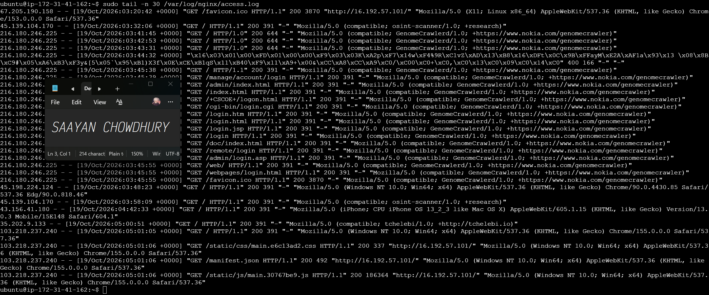

---

#### Screenshot 2 — Output of `sudo tail -n 30 /var/log/nginx/error.log`

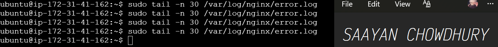

---

#### Screenshot 3 — Output of `sudo journalctl -u nginx --no-pager -n 50`

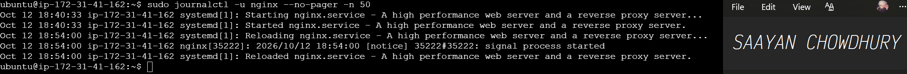

---

### Notes

Answer the following in your own words:

**1. Were there any errors in the logs?**

I didn't find any errors in the Nginx error log or the journalctl output. The logs showed normal events like Nginx starting, stopping and reloading successfully. This indicates that there were no visible service errors during my check.

---

**2. If there were no errors, what does that indicate about the system?**

It indicates that Nginx was running normally during my check and that no recent errors were recorded. However, an empty error log alone doesn't guarantee that the entire system is healthy, so other checks are also necessary.

---

**3. Based on the access logs, were your curl requests visible in the log entries? What does that prove about traffic flow?**

Yes, my curl requests were visible in the Nginx access logs. This confirms that the requests reached the web server and were processed and logged. It also shows that the client-to-server HTTP traffic was working as expected.

---

# Task 4 — System Resource Health Check (Capacity Red Flags)

## Goal

Assess server capacity and detect potential performance or failure risks.

### Evidence

#### Screenshot 1 — Output of `uptime`

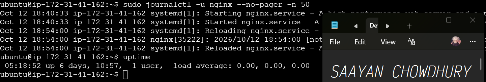

---

#### Screenshot 2 — Output of `free -h`

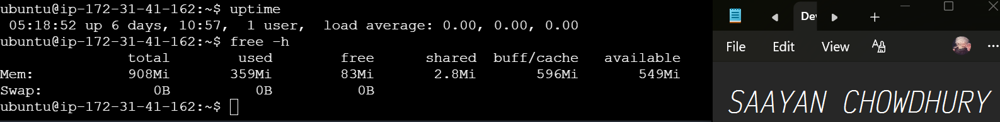

---

#### Screenshot 3 — Output of `df -h`

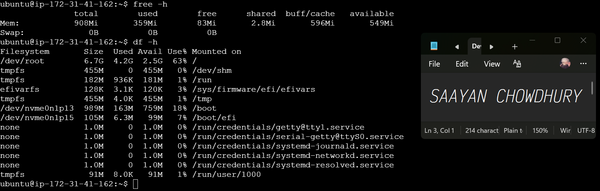

---

#### Screenshot 4 — Output of `sudo du -sh /var/* | sort -h`

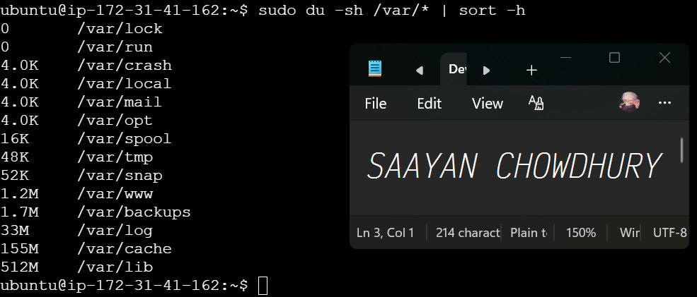

---

### Notes

Answer the following in your own words:

**1. Which resource looks most critical right now? (CPU/load, memory, or disk) Explain why.**

Memory looks like the resource I need to monitor most closely. The VM has only around 908 MB of RAM and no swap space configured, so increasing memory usage could affect performance. Disk usage is around 59%, with approximately 2.8 GB available. Since the screenshots don't provide enough information to judge CPU pressure, I can't conclude that CPU is a problem right now.

---

**2. What happens if disk becomes 100% full in a production server?**

If the disk becomes 100% full, applications may fail to write logs, temporary files or new data. This can cause services to malfunction or crash and may lead to downtime. I would check disk usage and remove unnecessary files or expand storage to restore normal operation.
---

# Task 5 — Configuration & Deployment Verification

## Goal

Ensure the correct React build is deployed and Nginx is serving it properly.

### Evidence

#### Screenshot 1 — Output of `ls -lah /var/www/html | head -n 20`

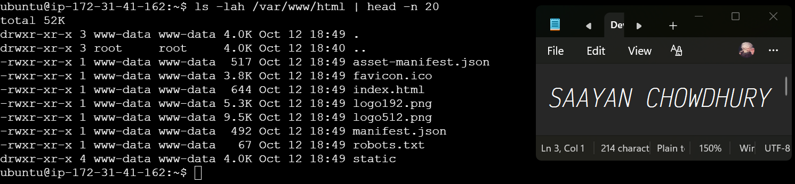

---

#### Screenshot 2 — Output of `grep -R "Deployed by" -n /var/www/html 2>/dev/null | head`

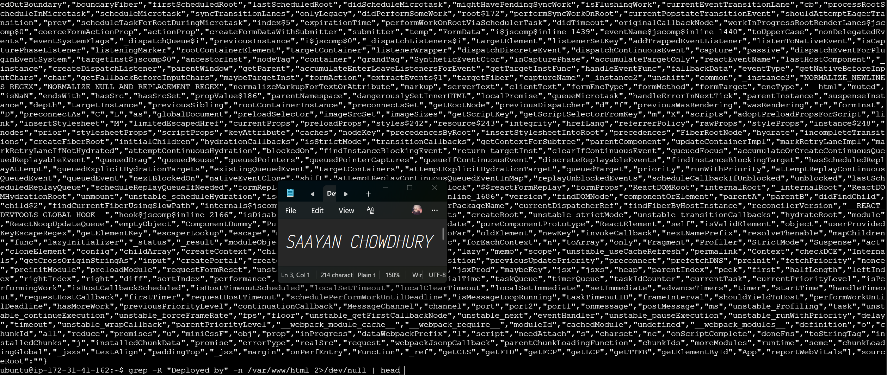

---

#### Screenshot 3 — Output of `grep -n "try_files" /etc/nginx/sites-available/default`

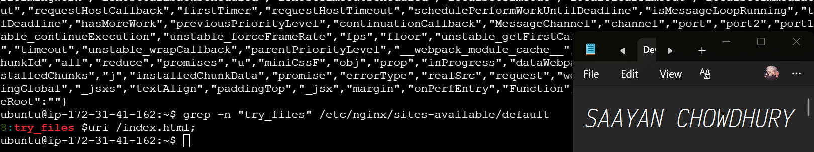

---

### Notes

Answer the following in your own words:

**1. How do you confirm that the correct version of the application is deployed?**

I would check the files inside /var/www/html to confirm that the React build is present. Then I would use grep -R "Deployed by" to verify the identifying text in the deployed files and check the Nginx try_files configuration. Finally, I would use curl to confirm that the server is actually serving the application over HTTP.

---

# Task 6 — Nginx Configuration Failure Simulation

## Goal

Simulate a real-world Nginx misconfiguration and recover the service safely.

### Evidence

#### Screenshot 1 — Output of `sudo nginx -t` showing the syntax error (broken config)

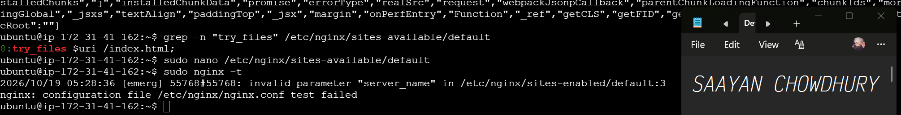

---

#### Screenshot 2 — Output of `sudo nginx -t` showing syntax ok (fixed config)

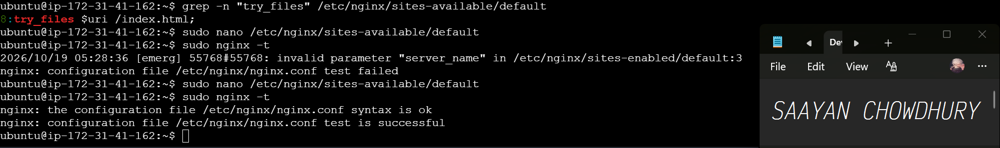

---

#### Screenshot 3 — Output of `curl -I http://<public-ip>` confirming recovery (200 OK)

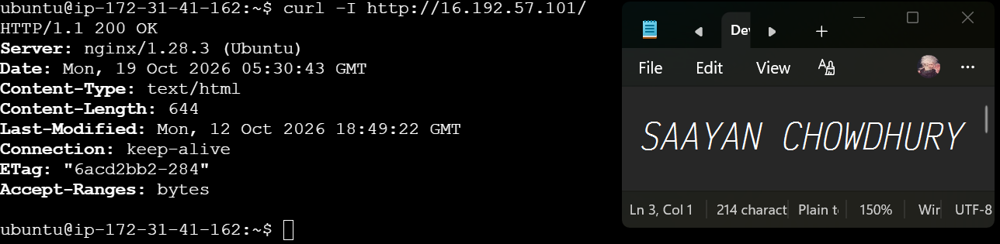

---

### Notes

Answer the following in your own words:

**1. What caused the configuration failure?**

The failure was caused by removing a semicolon from the Nginx configuration file. This created a syntax error, which caused sudo nginx -t to fail.

---

**2. How did you fix the issue?**

I fixed the issue by adding the missing semicolon back to the configuration file. After saving the changes, I ran sudo nginx -t again to confirm that the configuration was valid.

---

**3. How can you avoid this kind of issue in real production systems?**

I would run sudo nginx -t before reloading or restarting Nginx. Keeping configuration files in version control, reviewing changes before applying them and testing them in a staging environment would also help prevent such issues in production.

---

# Task 7 — Web Application Failure Simulation

## Goal

Simulate missing deployment content and recover the application safely.

### Evidence

#### Screenshot 1 — Output of `curl -I http://<public-ip>` showing failure (non-200 response)

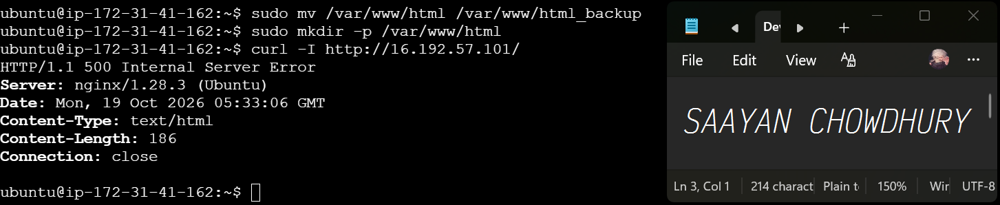

---

#### Screenshot 2 — Output of `curl -I http://<public-ip>` confirming recovery (200 OK)

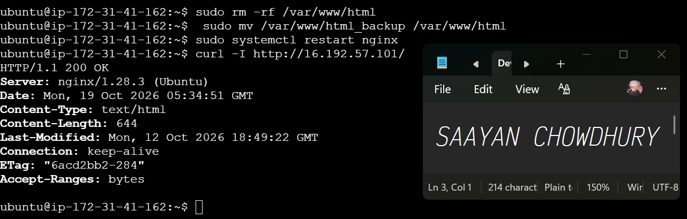

---

### Notes

Answer the following in your own words:

**1. What caused the application to break in this scenario?**

The application broke because the deployed files were removed from /var/www/html, which is the directory Nginx was serving. Since the required files, including index.html, were missing, Nginx could no longer serve the React application properly.

---

**2. How did you fix the issue and restore the application?**

I restored the application by moving the existing backup from html_backup back to its original location. After restoring the files, I restarted Nginx and used curl -I to verify that the server returned 200 OK. The matching response headers also confirmed that the original application build had been restored.

---

**3. What steps would you take to prevent this kind of issue in real production systems?**

I would keep a backup of the current application before every deployment and prepare the new build separately before making it live. I would also automate checks to verify that all required files are present and test the application after deployment. This would make it easier to detect problems early and roll back quickly if something goes wrong.

---

# Task 8 — Security & Reliability Review

## Goal

Review and reflect on the security and reliability practices applied during this assignment.

### Security & Reliability Notes

Answer the following in your own words:

**1. Why is SSH key-based authentication more secure than sharing passwords?**

A SSH key-based authentication is more secure because it uses a private key instead of relying only on a password. It reduces the risk of password guessing and unauthorized access, provided the private key is stored securely.

---

**2. Why should only required ports be open on a production server?**

Only the ports required by the application and its supporting services should be open. Closing unnecessary ports reduces the attack surface and limits the entry points attackers can try to exploit.

---

**3. Why is it important for Nginx to be enabled on boot?**

Enabling Nginx on boot ensures that the web server starts automatically whenever the server restarts. This helps keep the application available without requiring someone to start the service manually.

---

**4. What are the risks of sharing secrets, keys, or credentials publicly?**

Sharing secrets, keys or credentials publicly can allow unauthorized people to access servers, applications or cloud accounts. This can lead to data leaks, security breaches and unauthorized changes. Sensitive credentials should always be stored securely and never exposed in public repositories or screenshots.

---

**5. Why should cloud resources be stopped or terminated when they are no longer needed?**

A Unused cloud resources should be stopped or terminated to avoid unnecessary charges. Removing resources that are no longer required also reduces the risk of leaving unused services exposed to security threats.

---

# LinkedIn Post (Required)

## Evidence

#### LinkedIn Post URL

Paste your LinkedIn post URL here:

`https://www.linkedin.com/posts/saayan-chowdhury-pop2004_devops-agenticai-dmibypravinmishra-ugcPost-7517831495399546880-7Uy_/?highlightedUpdateUrn=urn%3Ali%3Aactivity%3A7517831496666341376&highlightedUpdateType=SOCIAL_SHARE&origin=SOCIAL_SHARE`

---

#### Screenshot — Published LinkedIn post

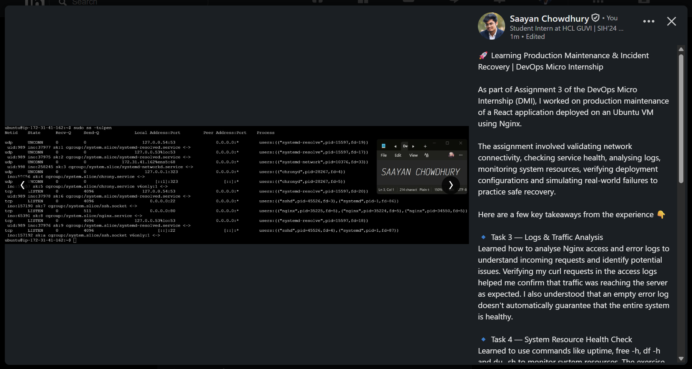

---

# Submission Instructions

- Add all required screenshots in your submission
- Full name must be visible in required screenshots
- Do not expose sensitive information (keys, passwords, account IDs)

---

# Completion Checklist

- [✅] Task 1: Screenshots (browser, ip a, ss -tulpen, ufw status) + Notes answered
- [✅] Task 2: Screenshots (nginx status, nginx -t, ss port 80) + Notes answered
- [✅] Task 3: Screenshots (access log, error log, journalctl) + Notes answered
- [✅] Task 4: Screenshots (uptime, free -h, df -h, du -sh) + Notes answered
- [✅] Task 5: Screenshots (ls html, grep deployed by, grep try_files) + Notes answered
- [✅] Task 6: Screenshots (nginx -t fail, nginx -t pass, curl recovery) + Notes answered
- [✅] Task 7: Screenshots (curl failure, curl recovery) + Notes answered
- [✅] Task 8: Security & Reliability Notes answered
- [✅] LinkedIn post published and URL submitted
- [✅] Full Name visible in all required screenshots
- [✅] No sensitive data exposed

---

## 📌 About DMI & CloudAdvisory

DevOps Micro Internship (DMI) is a project-based DevOps program run by Pravin Mishra (The CloudAdvisory) focused on real-world execution, systems thinking, and career readiness.

It helps learners build strong DevOps foundations with hands-on experience.

---

## 📌 Resources

- 🌐 DMI Official Website: https://dmi.pravinmishra.com?utm_source=github&utm_medium=readme  
- 🎓 University: https://university.pravinmishra.com?utm_source=github&utm_medium=readme  
- 💬 Discord Community: https://discord.pravinmishra.com?utm_source=github&utm_medium=readme  
- 📝 Blog: https://dmi.pravinmishra.com/blog?utm_source=github&utm_medium=readme  
- ▶️ YouTube Playlist: https://www.youtube.com/playlist?list=PLFeSNDtI4Cho  
- 🔗 Pravin Mishra (LinkedIn): https://www.linkedin.com/in/pravin-mishra-aws-trainer/  
- 🏢 CloudAdvisory (LinkedIn): https://www.linkedin.com/company/thecloudadvisory/

---

*This submission is part of DevOps Micro Internship (DMI) — Agentic AI Track.*