# Assignment 5 — Bash Script Automation Drill (OPS Checklist)

Part of the DevOps Micro Internship (DMI) with Agentic AI

---

## Purpose

In this assignment, you will practice Bash scripting by building a series of small automation scripts covering environment setup, variables, arrays, loops, file conditionals, if-else logic, and functions. These scripts form the foundation of real-world Linux automation used in DevOps, cloud, and production support environments.

---

# Task 1 — Bash Environment & Workspace Setup

## Goal

Verify that Bash is available on your system and create a clean workspace for this assignment.

### Evidence

#### Screenshot 1 — Output of `echo $SHELL` and `bash --version`

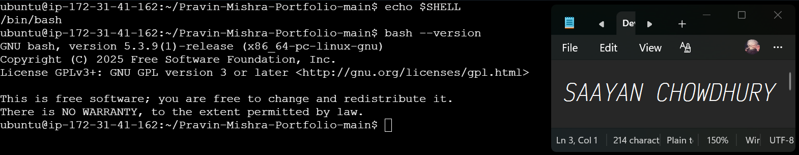

---

#### Screenshot 2 — Output of `pwd` and `ls -lah` showing the scripts directory

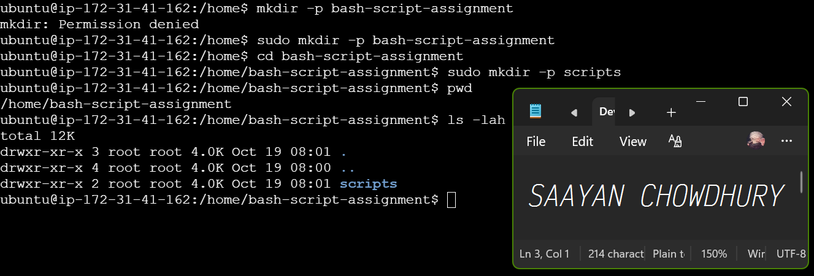

---

### Notes

Answer the following in your own words:

**1. What is Bash?**

Bash is a command-line shell and scripting language that lets us run commands and automate tasks on Linux and other Unix-based systems.

---

**2. What is the difference between shell and Bash?**

A shell is a program that lets us interact with the operating system through commands. Bash is one specific type of shell that also supports scripting and automation.

---

**3. Why is it important to confirm the Bash version before writing scripts?**

Different Bash versions support different features. Checking the version beforehand helps ensure that the script will work properly in the environment where it is being executed.

---

# Task 2 — Your First Bash Script

## Goal

Create your first Bash script, make it executable, and run it from the terminal.

### Evidence

#### Screenshot 1 — Content of `first-script.sh`

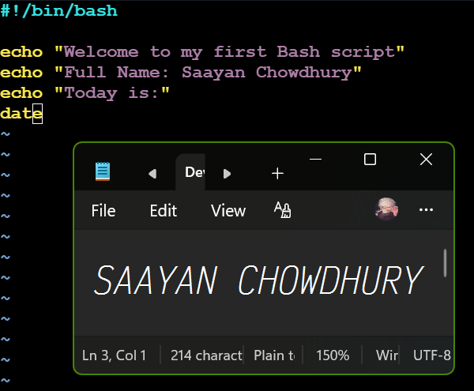

---

#### Screenshot 2 — Output of `./first-script.sh`

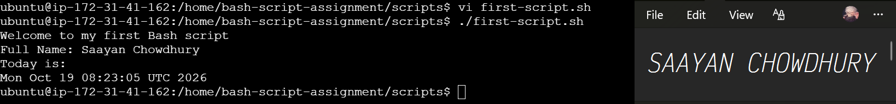

---

#### Screenshot 3 — Output of `ls -l first-script.sh` showing executable permission

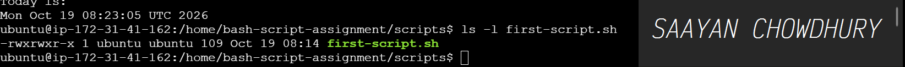

---

### Notes

Answer the following in your own words:

**1. What is the purpose of `#!/bin/bash`?**

It tells the operating system to use Bash to execute the script when I run it as an executable.

---

**2. Why do we use `chmod +x` before running a script?**

It gives the file executable permission, allowing me to run it directly using ./script.sh.

---

**3. What is the difference between running a script using `./script.sh` and `bash script.sh`?**

./script.sh runs the file as an executable using the interpreter specified in its shebang. On the other hand, bash script.sh explicitly runs the script using Bash without requiring executable permission.

---

# Task 3 — Variables: User Information Script

## Goal

Use variables to store and display user-related information.

### Evidence

#### Screenshot 1 — Content of `user-info.sh`

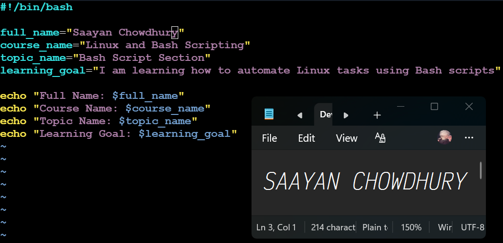

---

#### Screenshot 2 — Output of `./user-info.sh`

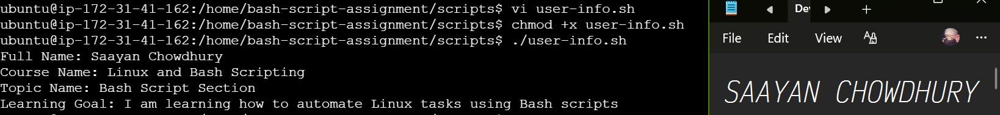

---

### Notes

Answer the following in your own words:

**1. What is a variable in Bash?**

A variable is like a container that stores a value which can be used later in the script.

---

**2. Why should we avoid spaces around the `=` sign when creating variables?**

In Bash, spaces around the = sign make variable assignment invalid. Bash treats the parts as separate commands or arguments instead of assigning the value to the variable.

---

**3. How do you access the value stored inside a Bash variable?**

By using the $ symbol before the variable name. For example, $full_name gives me the value stored in the full_name variable.

---

# Task 4 — Arrays & Loops: Tools Checklist Script

## Goal

Use arrays and loops to print a checklist of tools used in Bash scripting.

### Evidence

#### Screenshot 1 — Content of `tools-checklist.sh`

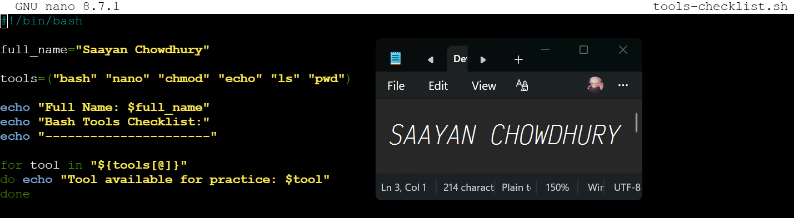

---

#### Screenshot 2 — Output of `./tools-checklist.sh`

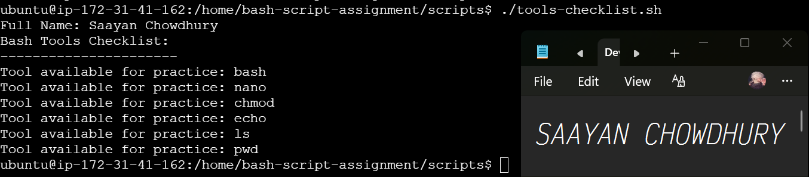

---

### Notes

Answer the following in your own words:

**1. What is an array in Bash?**

Unlike a normal variable that usually stores a single value, an array stores multiple values under one name.

---

**2. Why are arrays useful in scripts?**

Arrays let us store multiple values in one place, making it easier to organize, access and process lists of data without creating separate variables for every value.

---

**3. What does `"${tools[@]}"` mean?**

It represents all the elements stored in the tools array, allowing me to access each element separately.

---

**4. What is the purpose of the `for` loop in this script?**

The for loop goes through each item in the array and executes the same block of commands for every item. This avoids writing the same code multiple times.

---

# Task 5 — Loops: Number Counter Script

## Goal

Use loops to repeat a task multiple times.

### Evidence

#### Screenshot 1 — Content of `counter.sh`

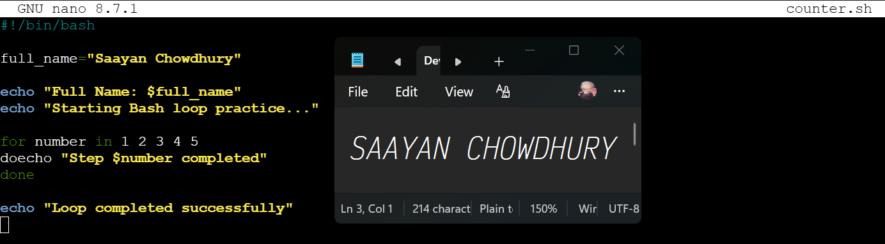

---

#### Screenshot 2 — Output of `./counter.sh`

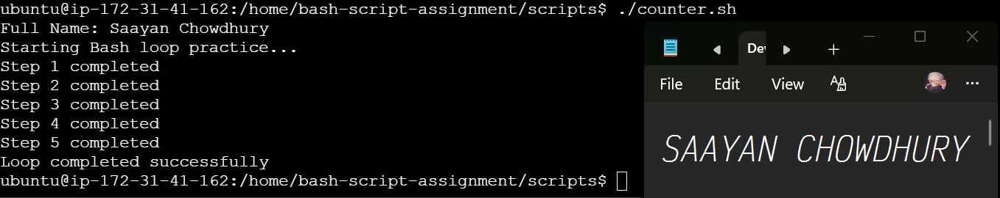

---

### Notes

Answer the following in your own words:

**1. What is a loop?**

A loop is a programming structure that repeats a set of commands until all items are processed or a specified condition is met.

---

**2. Why do we use loops in Bash scripting?**

We use loops to automate repetitive tasks instead of writing the same commands again and again.

---

**3. How many times did the loop run in your script?**

The loop ran five times because the array contained five values.

---

**4. What would you change if you wanted the loop to run 10 times?**

I would add five more values to the list, covering numbers 6 to 10, so that the loop could process all ten values.

---

# Task 6 — Files & Conditionals: File Validation Script

## Goal

Use file checks and conditionals to verify whether files and directories exist.

### Evidence

#### Screenshot 1 — Output of `ls -lah ../test-folder`

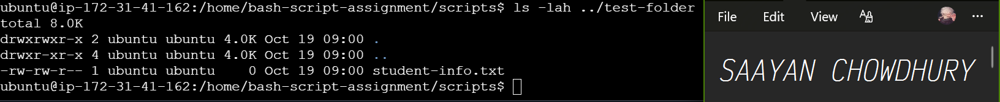

---

#### Screenshot 2 — Content of `file-check.sh`

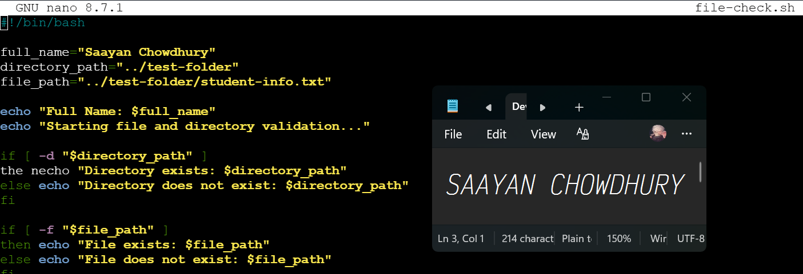

---

#### Screenshot 3 — Output of `./file-check.sh`

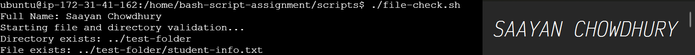

---

### Notes

Answer the following in your own words:

**1. What does `-d` check in Bash?**

-d checks whether the specified path exists and is a directory.

---

**2. What does `-f` check in Bash?**

-f checks whether the specified path exists and is a regular file rather than a directory.

---

**3. Why should file and directory paths be stored in variables?**

Storing paths in variables makes the script easier to read, update and reuse. If a path changes, I only need to update it in one place instead of modifying it throughout the script.

---

**4. What happens if the file does not exist?**

If the file doesn't exist, the -f condition evaluates to false and the else block executes. The script then displays a message indicating that the file does not exist.

---

# Task 7 — Conditionals: Pass or Retry Script

## Goal

Use if-else conditionals to make decisions based on a variable value.

### Evidence

#### Screenshot 1 — Content of `score-check.sh` with `score=85`

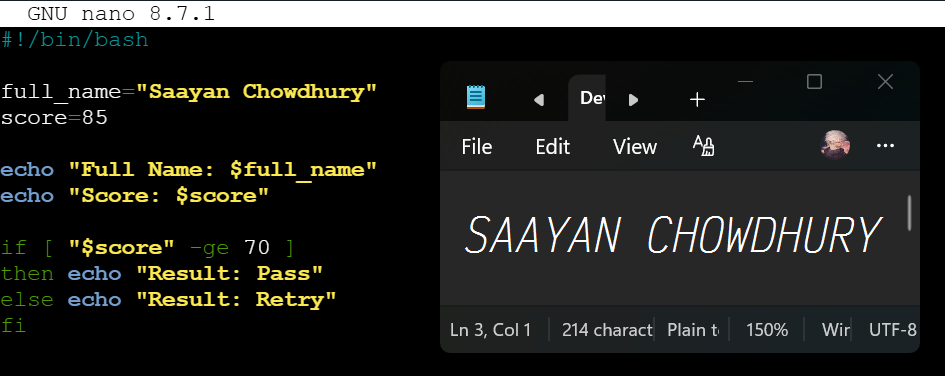

---

#### Screenshot 2 — Output showing `Result: Pass`

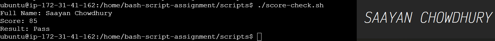

---

#### Screenshot 3 — Content of `score-check.sh` with `score=55`

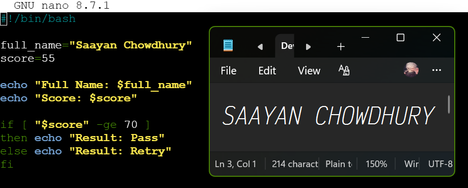

---

#### Screenshot 4 — Output showing `Result: Retry`

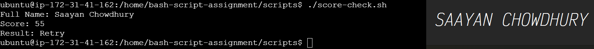

---

### Notes

Answer the following in your own words:

**1. What is the purpose of if-else in Bash?**

if-else statements allow a script to make decisions based on conditions and execute different commands depending on whether those conditions are true or false.

---

**2. What does `-ge` mean?**

-ge means greater than or equal to. It is used to compare integer values in Bash.

---

**3. Why should conditions be tested with different values?**

Testing conditions with different values helps ensure that the script handles different scenarios correctly and produces the expected output.

---

**4. How can conditionals help in automation scripts?**

Conditionals allow automation scripts to make decisions instead of executing the same commands every time. They can check the current state of the system and perform the appropriate action based on the result.

---

# Task 8 — Functions: Final Bash Automation Script

## Goal

Create a final Bash script using functions to organize reusable code.

### Evidence

#### Screenshot 1 — Content of `final-automation.sh`

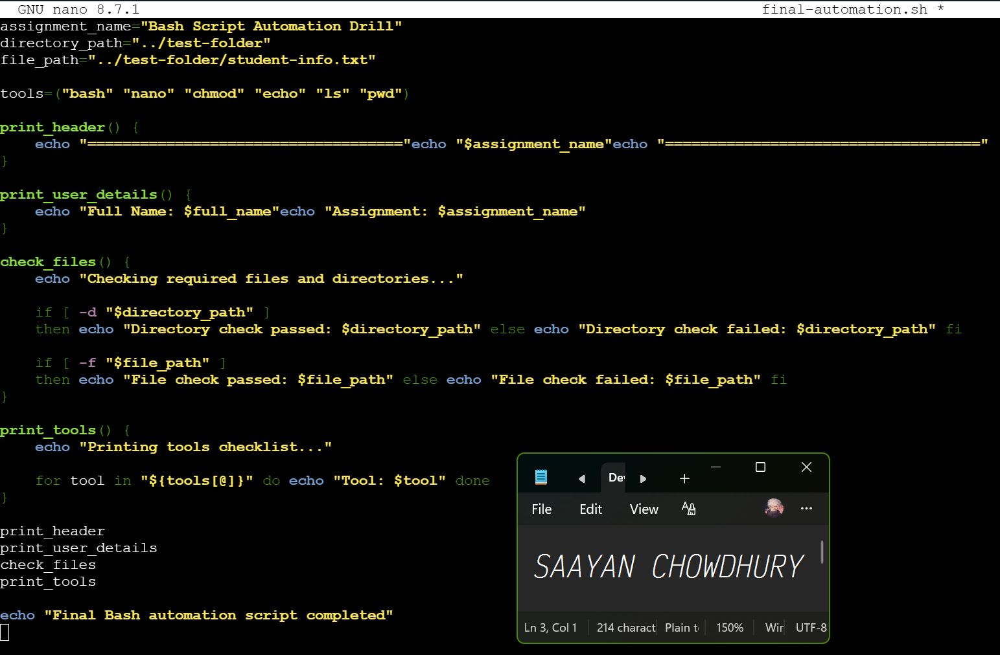

---

#### Screenshot 2 — Output of `./final-automation.sh`

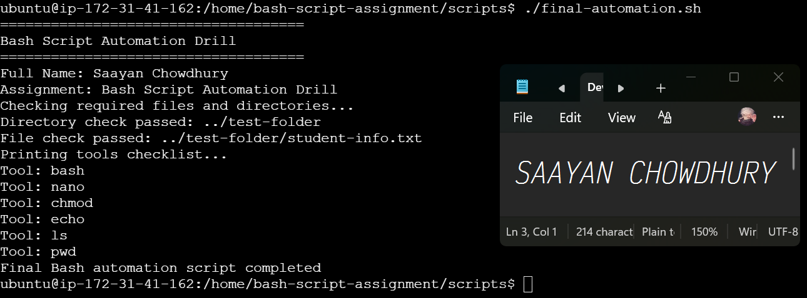

---

#### Screenshot 3 — Output of `ls -lah` showing all created scripts

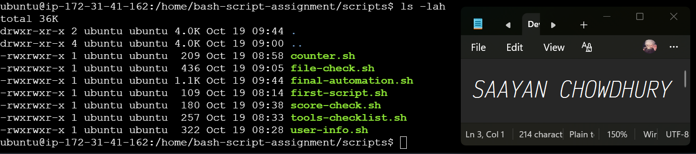

---

### Notes

Answer the following in your own words:

**1. What is a function in Bash?**

A function in Bash is a named block of commands that can be reused whenever needed, instead of writing the same code multiple times.

---

**2. Why are functions useful in scripts?**

Functions reduce repetition and make scripts easier to read, organize and maintain. They also allow me to reuse the same block of code whenever required.

---

**3. Which functions did you create in this script?**

I created four functions:
1. print_header displays the assignment header.
2. print_user_details displays my full name and the assignment title.
3. check_files checks whether the required directory and file exist.
4. print_tools loops through the array and displays each tool one by one.

---

**4. How does this final script combine variables, arrays, loops, conditionals, files, and functions?**

The script combines different Bash concepts to complete the task. Variables store my name, the assignment title and the file and directory paths. An array holds the list of tools, while a loop goes through the array and displays each tool. Conditionals check whether the required directory and file exist before displaying the appropriate messages. Finally, functions organize the different operations into reusable blocks, making the script easier to read, manage and maintain.

---

# LinkedIn Post (Required)

## Evidence

#### LinkedIn Post URL

Paste your LinkedIn post URL here:

`https://www.linkedin.com/posts/saayan-chowdhury-pop2004_devops-bashscripting-linux-share-7517889102927794177-Cscw/?highlightedUpdateUrn=urn%3Ali%3Aactivity%3A7517889105582747648&highlightedUpdateType=SOCIAL_SHARE&origin=SOCIAL_SHARE&utm_source=share&utm_medium=member_desktop&rcm=ACoAAFKNFu0BzZBIwP_0LZpQ5nnIuLGv6FIOItw`

---

#### Screenshot — Published LinkedIn post

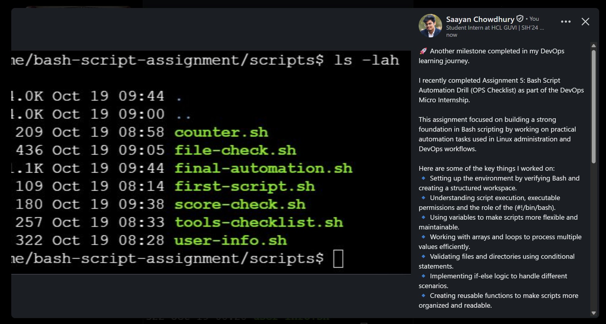

---

# Submission Instructions

- Add all required screenshots in your submission
- Full name must be visible in required screenshots
- All script files must be created and run successfully
- Required notes must be answered clearly for every task
- Do not expose sensitive information (keys, passwords, credentials)

---

# Completion Checklist

- [✅] Task 1: Environment setup verified, workspace created (Screenshots 1–2, Notes answered)
- [✅] Task 2: First script created, executed, permissions verified (Screenshots 1–3, Notes answered)
- [✅] Task 3: Variables script created and run (Screenshots 1–2, Notes answered)
- [✅] Task 4: Arrays and loops script created and run (Screenshots 1–2, Notes answered)
- [✅] Task 5: Counter loop script created and run (Screenshots 1–2, Notes answered)
- [✅] Task 6: File validation script created and run (Screenshots 1–3, Notes answered)
- [✅] Task 7: Pass/Retry conditional script tested with both values (Screenshots 1–4, Notes answered)
- [✅] Task 8: Final automation script created and run (Screenshots 1–3, Notes answered)
- [✅] All scripts run without errors
- [✅] Full Name visible in all required screenshots
- [✅] LinkedIn post published and URL submitted
- [✅] No sensitive data exposed

---

## 📌 About DMI & CloudAdvisory

DevOps Micro Internship (DMI) is a project-based DevOps program run by Pravin Mishra (The CloudAdvisory) focused on real-world execution, systems thinking, and career readiness.

It helps learners build strong DevOps foundations with hands-on experience.

---

## 📌 Resources

- 🌐 DMI Official Website: https://dmi.pravinmishra.com?utm_source=github&utm_medium=readme  
- 🎓 University: https://university.pravinmishra.com?utm_source=github&utm_medium=readme  
- 💬 Discord Community: https://discord.pravinmishra.com?utm_source=github&utm_medium=readme  
- 📝 Blog: https://dmi.pravinmishra.com/blog?utm_source=github&utm_medium=readme  
- ▶️ YouTube Playlist: https://www.youtube.com/playlist?list=PLFeSNDtI4Cho  
- 🔗 Pravin Mishra (LinkedIn): https://www.linkedin.com/in/pravin-mishra-aws-trainer/  
- 🏢 CloudAdvisory (LinkedIn): https://www.linkedin.com/company/thecloudadvisory/

---

*This submission is part of DevOps Micro Internship (DMI) — Agentic AI Track.*