# Assignment 6 — Build an AI-Assisted Linux Health Check (AI-Assisted Linux Incident Triage)

Part of the DevOps Micro Internship (DMI) with Agentic AI

---

## Purpose

In this assignment, you will build a read-only Bash triage script that checks the health of your Ubuntu server and Nginx application, connect it to Claude Code as a reusable `/linux-triage` skill, simulate a controlled Nginx incident, use the skill to gather and analyze evidence, recover the service manually, and verify recovery. The workflow follows the Agentic Loop: Gather → Analyze → Human Act → Verify.

---

# Task 1 — Confirm the Healthy Baseline and Create the Workspace

## Goal

Confirm that Nginx and the React application are healthy before building the automation.

### Evidence

#### Screenshot 1 — Output of `systemctl is-active nginx`, `ss -ltn | grep ':80'`, and `curl -I http://localhost`

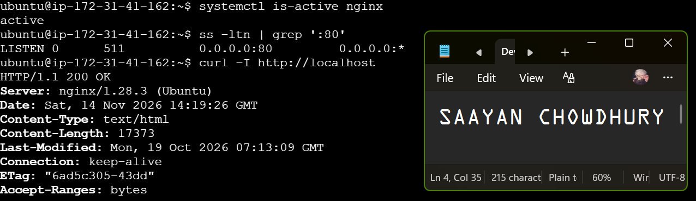

---

#### Screenshot 2 — Output of `pwd` and `find . -maxdepth 4 -type d | sort` showing the workspace folder structure

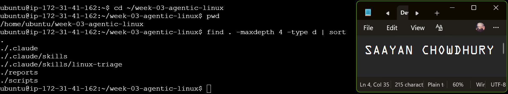

---

### Notes

Answer the following in your own words:

**1. What proves that Nginx is running?**

When I run systemctl is-active nginx, the output should be active. This confirms that the Nginx service is running.

---

**2. What proves that the server is listening for HTTP traffic?**

The command ss -ltn | grep ':80' should show a listening socket on port 80. This confirms that the server is accepting HTTP connections on that port.

---

**3. Why must you capture a healthy baseline before simulating an incident?**

I need to confirm that everything is working before creating the incident. This gives me a healthy state to compare against after the failure is introduced. Once I recover the service, I can run the same checks again and verify that the system has returned to its original working state.

---

# Task 2 — Create Project Context and Safety Rules in CLAUDE.md

## Goal

Tell Claude exactly what this project does and what it is not allowed to do.

### Evidence

#### Screenshot 3 — CLAUDE.md open in VS Code showing all four sections (Project Overview, Incident Workflow, Safety Rules, Output Rules)

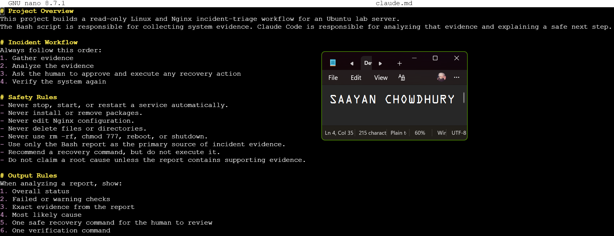

---

### Notes

Answer the following in your own words:

**1. Why should Claude receive project-specific operational rules?**

Claude needs to understand what the project does and which steps it is expected to follow. Project-specific rules also define what it must avoid. This keeps its recommendations relevant to the incident workflow and prevents unnecessary or unsafe changes.

---

**2. Why is the human required to execute the recovery command?**

The human should review the collected evidence and decide whether the suggested recovery action is safe. Claude can recommend a command based on the findings, but it should not make changes to the server on its own. This keeps the recovery process under human control.

---

**3. Which rule prevents Claude from making an unsupported diagnosis?**

The rule is: “Do not claim a root cause unless the report contains supporting evidence.” It ensures that Claude bases its diagnosis on the collected results instead of making assumptions.

---

# Task 3 — Use Agentic AI to Plan Before Writing the Script

## Goal

Use Claude Code to inspect the environment and produce a read-only plan before creating any Bash code.

### Evidence

#### Screenshot 4 — Claude Code showing the five-check plan and read-only inspection results

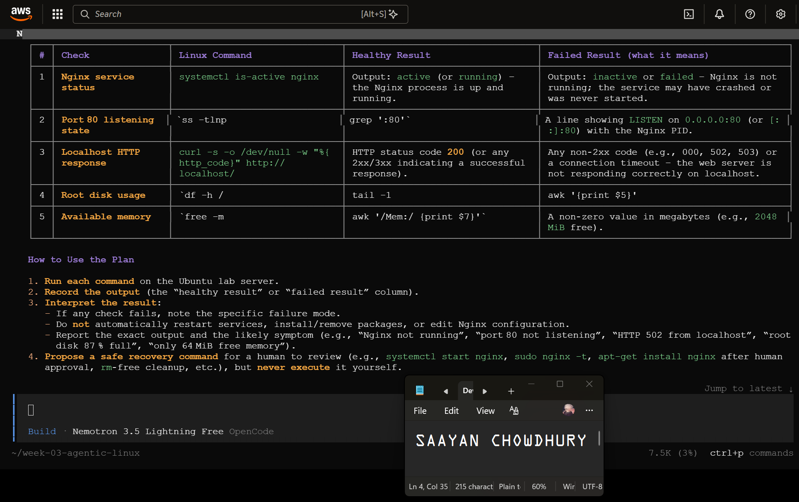

---

### Notes

Answer the following in your own words:

**1. Which part of this task represents the Gather phase?**

The read-only inspection of the Ubuntu server represents the Gather phase. Claude collects information about the Nginx service, port 80, HTTP response, disk usage and available memory without changing anything on the server.

---

**2. Did Claude follow the instruction not to create files? How did you verify this?**

Yes. Claude performed the requested read-only checks and did not create any files. I verified this by listing the workspace contents and checking that no Bash script or other new file had appeared.

---

**3. Why is planning before coding useful in DevOps automation?**

Planning helps me identify what needs to be checked and how each result should be interpreted before writing the script. It also gives me a chance to identify missing checks or unsafe operations early. This makes the implementation more organised and reduces the chance of having to fix avoidable issues later.

---

# Task 4 — Build the Linux Triage Bash Script

## Goal

Create one Bash script that gathers consistent Linux and Nginx health evidence.

### Evidence

#### Screenshot 5 — Top section of `linux-triage.sh` showing variables, thresholds, and the checks array

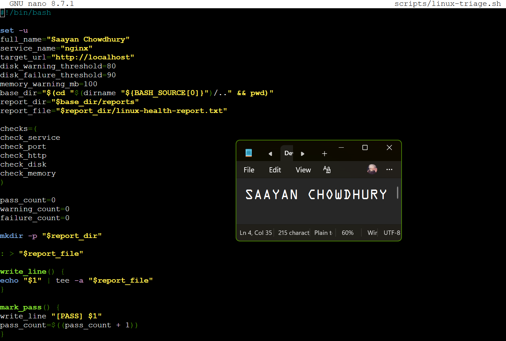

---

#### Screenshot 6 — Middle section showing check functions and conditionals

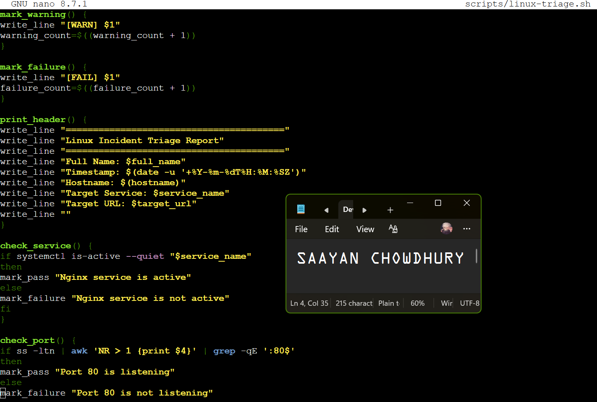

---

#### Screenshot 7 — Bottom section showing the loop, summary function, and exit behavior

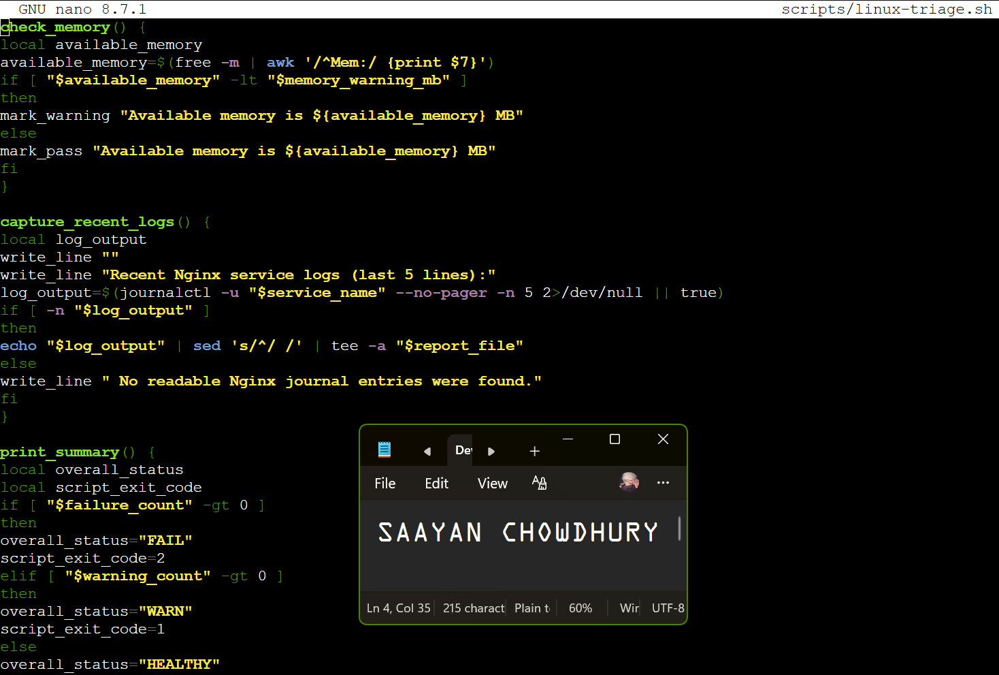

---

#### Screenshot 8 — Output of `bash -n scripts/linux-triage.sh` (no syntax errors) and `ls -l scripts/linux-triage.sh` showing executable permission

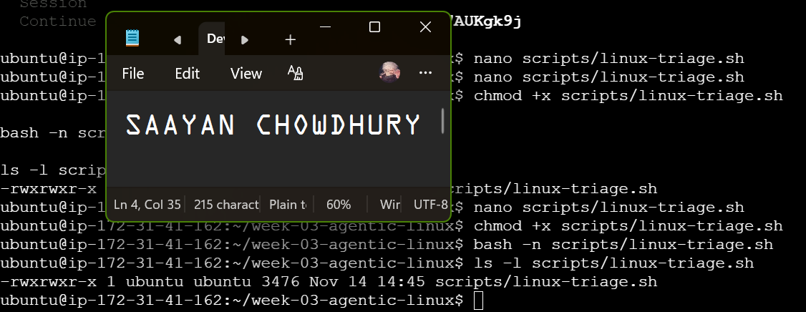

---

### Notes

Answer the following in your own words:

**1. What is stored in the checks array?**

The checks array stores the names of the five functions used to check the Nginx service, port 80, HTTP response, disk usage and available memory.

---

**2. How does the `for` loop use that array?**

The for loop goes through each function name in the array and executes the functions one by one. This allows the script to run all five health checks in a consistent order.

---

**3. Why are the health checks separated into functions?**

Each function handles one specific health check. This keeps the script modular and easier to read. It also makes individual checks easier to test, maintain and troubleshoot without affecting the other parts of the script.

---

**4. What is the purpose of `$(...)` in this script?**

The $(...) syntax runs a command and captures its output so that the result can be used elsewhere in the script. Here, it is used to collect values such as the timestamp, hostname, HTTP status code, disk usage, available memory and recent Nginx logs.

---

**5. Why does the script use different exit codes for HEALTHY, WARN, and FAIL?**

The exit code gives a quick indication of the overall server health after the checks finish. It also allows another script or automation tool to identify the result without having to read the full report.
- 0 means all health checks passed and the status is HEALTHY.
- 1 means one or more warnings were detected.
- 2 means at least one health check failed.

---

# Task 5 — Run and Understand the Healthy-State Report

## Goal

Run the Bash script against the healthy server and verify that it creates a report.

### Evidence

#### Screenshot 9 — Output of `./scripts/linux-triage.sh` showing your Full Name and all five check results

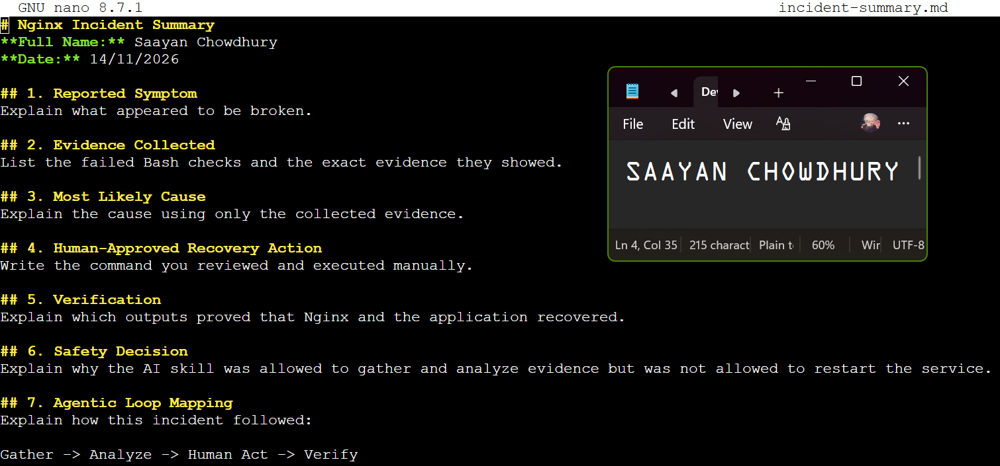

---

#### Screenshot 10 — Output showing the captured exit code and final summary

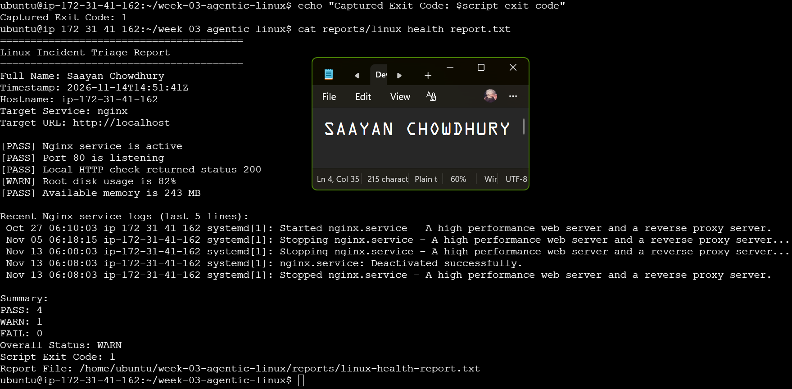

---

### Notes

Answer the following in your own words:

**1. What is the overall status of your healthy baseline?**

The overall status is HEALTHY because none of the checks failed.

---

**2. Which exact Linux evidence proves the application is serving traffic?**

The report shows that port 80 is listening and the local HTTP check returned status code 200. This confirms that the server is accepting HTTP connections and the application is responding successfully through Nginx.

---

**3. Did your script return exit code 0 or 1? Explain why.**

The script returned exit code 1 because 4 health checks passed. Nginx was active, port 80 was listening, the application returned an HTTP 200 response but disk usage and available memory were higher than the defined limits.

---

**4. What is the difference between a warning and a failure in this script?**

A warning means the server is still functioning but a resource condition needs attention. In this script, a warning is raised when root disk usage is between 80% and 89% or available memory falls below 100 MB.

A failure means a critical health check has failed. This happens when Nginx is inactive, port 80 is not listening, the application does not return an HTTP 200 response or root disk usage reaches 90% or higher.

---

# Task 6 — Create and Run the /linux-triage Skill

## Goal

Turn the Bash script into a reusable, manually invoked Agentic AI workflow.

### Evidence

#### Screenshot 11 — `SKILL.md` showing the frontmatter, allowed tool restrictions, and safety rules

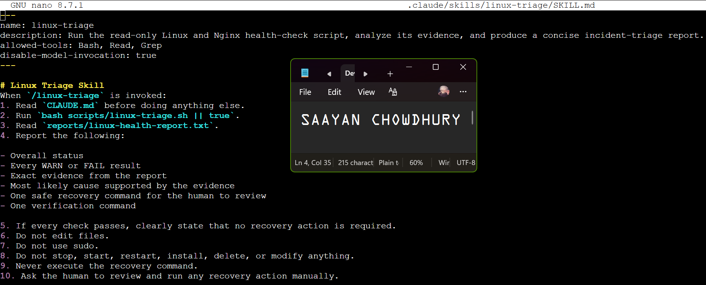

---

#### Screenshot 12 — `/linux-triage` output for the healthy server

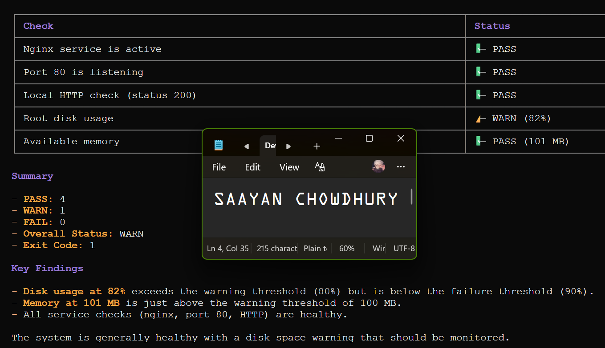

---

### Notes

Answer the following in your own words:

**1. Why does this skill have Bash, Read, and Grep, but not Write?**

The skill uses Bash to run the Linux triage script, Read to open the generated report and Grep to find specific PASS, WARN or FAIL results. It does not need the Write tool because its job is to inspect the evidence and explain the findings, not create or modify project files during triage.

---

**2. Why is `disable-model-invocation: true` useful for this skill?**

This setting prevents Claude from choosing and running the skill automatically. I have to invoke /linux-triage manually, which means I stay in control of when the server inspection begins.

---

**3. What part is performed by Bash, and what part is performed by Claude?**

The Bash script performs the health checks for Nginx, port 80, the HTTP response, disk usage and available memory. It also collects recent Nginx logs and saves the results in linux-health-report.txt.

Claude reads the report, interprets the results, points out warnings or failures and recommends the next step. It does not perform the recovery action itself.

---

**4. Why is this better than asking Claude "Is my server healthy?" without giving it evidence?**

Asking a general question does not give Claude enough information about the server's actual condition. The /linux-triage skill first collects real system evidence through the Bash script. Claude can then analyse the service status, listening port, HTTP response, disk usage, available memory and recent logs. This makes its recommendations evidence-based rather than assumptions.

---

# Task 7 — Simulate an Nginx Incident and Let the Skill Diagnose It

## Goal

Create a controlled service failure, gather evidence through Bash, and let Claude analyze the evidence without taking recovery action.

### Evidence

#### Screenshot 13 — Output showing Nginx is inactive and the HTTP request fails

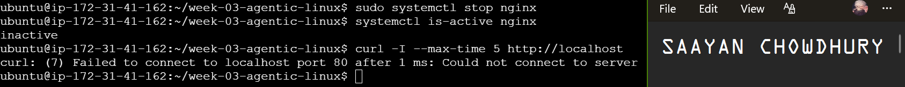

---

#### Screenshot 14 — `/linux-triage` output showing failed evidence, most likely cause, and a suggested recovery command

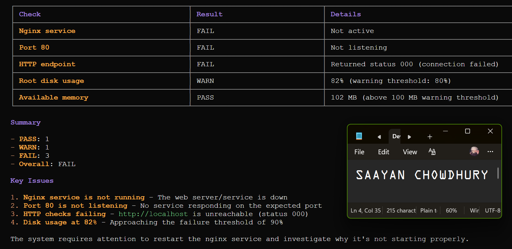

---

#### Screenshot 15 — `incident-failure-report.txt` showing the failed checks and your Full Name

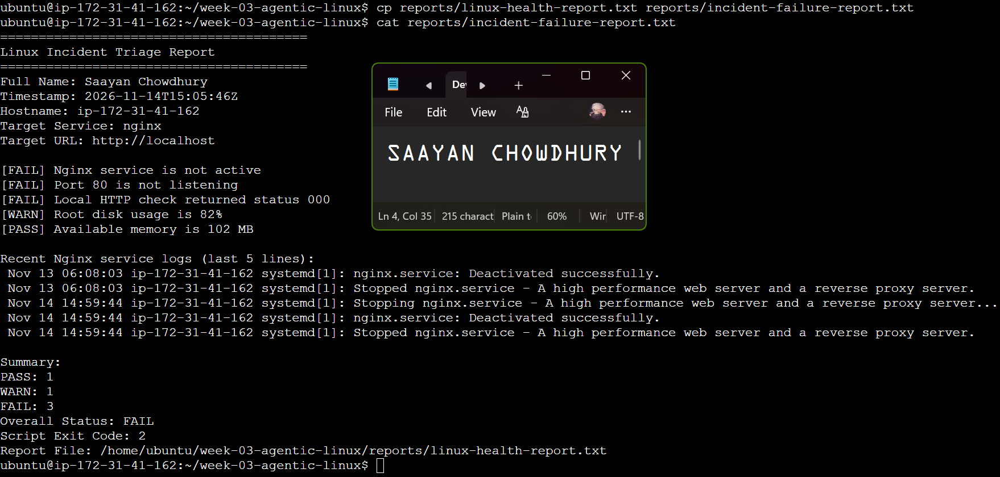

---

### Notes

Answer the following in your own words:

**1. Which three checks failed?**

The Nginx service check, port 80 check and local HTTP check failed.

---

**2. What evidence supports the conclusion that Nginx is unavailable?**

The report shows that Nginx is inactive, port 80 is not listening and the local HTTP check returned status code 000. These results indicate that Nginx is unavailable and the application cannot receive HTTP traffic.

---

**3. Did Claude execute the recovery command? Why is that important?**

No. Claude only suggested the recovery command and did not execute it. This is important because I need to review the evidence and decide whether the suggested action is appropriate before making any changes to the server. It prevents the AI from modifying a live service without human approval.

---

**4. Which phase of the Agentic Loop is represented by the Bash report?**

The Bash report represents the Gather phase because it collects and records the system's current state.

---

**5. Which phase is represented by Claude's explanation?**

Claude's explanation represents the Analyze phase because it interprets the collected evidence, identifies the failed checks and recommends a possible recovery action.

---

# Task 8 — Recover Manually, Verify Again, and Write the Incident Summary

## Goal

Recover the service as the human operator and prove that the system is healthy again.

### Evidence

#### Screenshot 16 — Output showing Nginx is active and `curl -I http://localhost` returns 200 OK

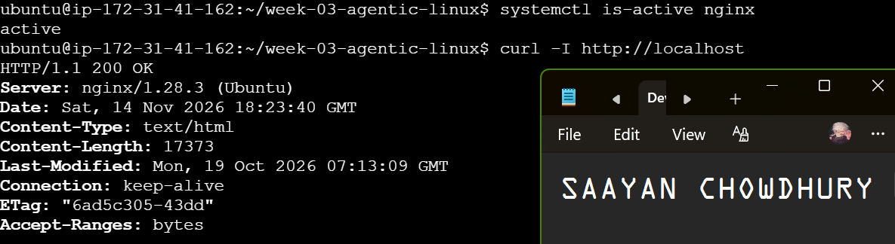

---

#### Screenshot 17 — Second `/linux-triage` output showing successful recovery with no FAIL results

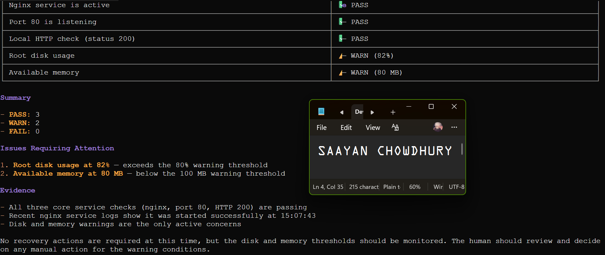

---

#### Screenshot 18 — Output of `ls -lah reports` showing both `incident-failure-report.txt` and `recovery-report.txt`

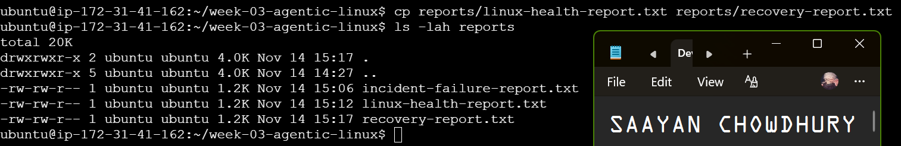

---

#### Screenshot 19 — `incident-summary.md` showing all required sections and your Full Name

---

### Notes

Answer the following in your own words:

**1. What action did you execute manually?**

I manually executed sudo systemctl start nginx to start the Nginx service again.

---

**2. What evidence proves that the service recovered?**

The systemctl is-active nginx command returned active and the local HTTP request returned HTTP/1.1 200 OK. The second /linux-triage run also confirmed that Nginx was active, port 80 was listening and the HTTP check passed.

---

**3. Why is the second triage run necessary?**

Starting Nginx does not automatically prove that the entire application is healthy. The second triage run checks the service, port, HTTP response, disk usage and available memory again. This confirms that the recovery was successful and that the server is back in a healthy state.

---

**4. What could go wrong if an AI agent automatically restarted every failed service?**

A service failure could be caused by a configuration issue, resource constraint, dependency failure or another underlying problem. Automatically restarting it could hide the actual cause, lead to repeated restart failures or make the incident worse. I should review the evidence first and approve a recovery action only when it is appropriate.

---

**5. In one sentence, explain the difference between using AI as a chatbot and using AI in this agentic workflow.**

A chatbot mainly responds to my questions, whereas in this agentic workflow Claude uses tools to collect and analyse real server evidence before recommending an action, while I remain responsible for approving and carrying out the recovery.

---

# Incident Summary

Fill in all seven sections below in your own words.

**Full Name:** Add your full name here

**Date:** DD/MM/YYYY

---

**1. Reported Symptom**

The EpicReads React application became unreachable. When I ran curl -I --max-time 5 http://localhost, the request failed to return a valid HTTP response. This indicated that the application was no longer serving traffic through the local server.

---

**2. Evidence Collected**

The Bash triage script (linux-triage.sh) reported three failed checks:
- [FAIL] Nginx service is not active — systemctl is-active nginx returned inactive instead of active.
- [FAIL] Port 80 is not listening — ss -ltn | grep ':80' showed no listening entry for port 80.
- [FAIL] Local HTTP check returned status 000 — curl -I http://localhost did not receive a valid HTTP response. Status code 000 indicates that the connection could not be established.

---

**3. Most Likely Cause**

The collected evidence points to the Nginx service being stopped. Since Nginx was inactive, no process was listening on port 80, which explains why the local HTTP request failed. All three failed checks are consistent with Nginx not running. The report supports this diagnosis, although it does not establish why the service stopped.

---

**4. Human-Approved Recovery Action**

sudo systemctl start nginx

Claude Code recommended this command based on the collected evidence but did not execute it. I reviewed the recommendation and ran the command manually as the human operator.

---

**5. Verification**

After starting Nginx, I checked the service and application again:
- systemctl is-active nginx returned active.
- curl -I http://localhost returned HTTP/1.1 200 OK.
- A second /linux-triage run showed that the Nginx service, port 80 and HTTP checks had passed. The overall status was HEALTHY with no failed checks.
These results confirm that the service recovered and the application was responding again.

---

**6. Safety Decision**

The AI skill was restricted to read-only tools: Bash, Read and Grep. It did not have Write permission. The CLAUDE.md rules also prevented Claude from starting, stopping or restarting services. I kept this restriction because a service failure can have causes that are not immediately clear from the initial evidence, such as a configuration problem, resource issue or dependency failure. An automatic restart could hide the underlying cause, cause repeated failures or make the incident worse. Keeping a human in the loop allowed me to review the findings and approve the recovery action before changing the server.

---

**7. Agentic Loop Mapping**

Gather — The Bash script collected read-only evidence about the Nginx service, port 80, local HTTP response, disk usage and available memory. It saved the results in linux-health-report.txt.
Analyze — Claude Code used the /linux-triage skill to read the report, identify the failed checks and explain that Nginx was inactive. It recommended sudo systemctl start nginx but did not run the command.
Human Act — I reviewed the evidence and Claude's recommendation, then manually executed sudo systemctl start nginx to start the service.
Verify — I ran /linux-triage again. The new report showed that all checks passed, confirming that the recovery action had restored the service.
---

# LinkedIn Post (Required)

## Evidence

#### LinkedIn Post URL

Paste your LinkedIn post URL here:

`https://www.linkedin.com/posts/saayan-chowdhury-pop2004_devops-agenticai-linux-share-7527459087891140609-q3Ih/?utm_source=share&utm_medium=member_desktop&rcm=ACoAAFKNFu0BzZBIwP_0LZpQ5nnIuLGv6FIOItw`

---

#### Screenshot — Published LinkedIn post

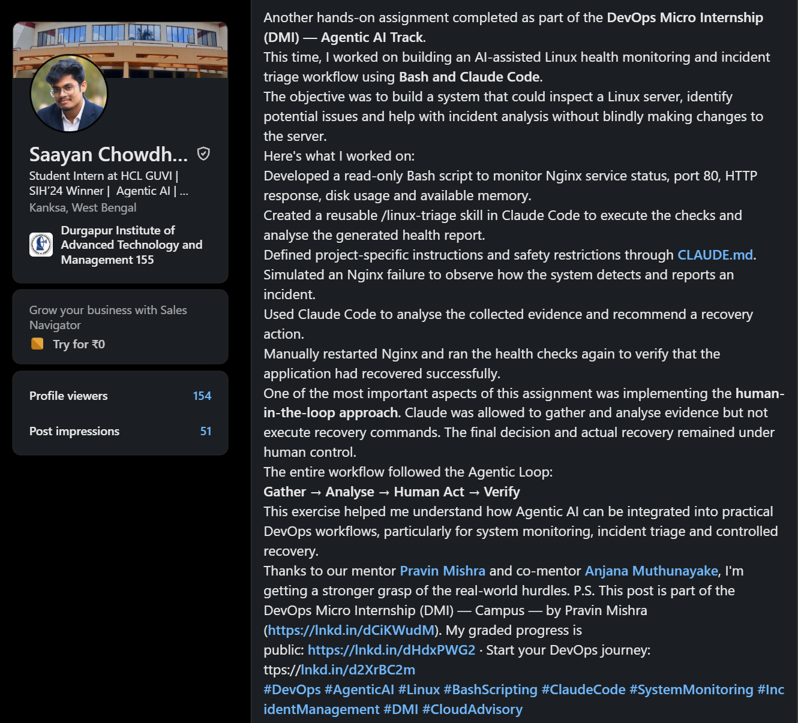

---

# GitHub Repository URL

Paste the URL of your GitHub folder or repository containing the assignment files here:

`https://github.com/ayomikunphilip/devops-micro-internship-pravinmishra`

---

# Submission Instructions

- Add all required screenshots in your submission
- Full Name must be visible in required screenshots and the Bash report
- All written answers must be in your own words
- Do not expose sensitive information (keys, passwords, AWS account IDs, tokens)
- GitHub URL must be included in this document

---

# Completion Checklist

- [✅] Task 1: Healthy baseline confirmed, workspace created (Screenshots 1–2, Notes answered)
- [✅] Task 2: CLAUDE.md created with all four sections (Screenshot 3, Notes answered)
- [✅] Task 3: Five-check plan produced by Claude using read-only tools (Screenshot 4, Notes answered)
- [✅] Task 4: `linux-triage.sh` created, syntax validated, executable permission set (Screenshots 5–8, Notes answered)
- [✅] Task 5: Healthy-state report generated with no FAIL result (Screenshots 9–10, Notes answered)
- [✅] Task 6: `/linux-triage` skill created and run successfully on healthy server (Screenshots 11–12, Notes answered)
- [✅] Task 7: Nginx incident simulated, failed evidence captured, Claude did not execute recovery (Screenshots 13–15, Notes answered)
- [✅] Task 8: Nginx recovered manually, recovery verified, reports saved, incident summary complete (Screenshots 16–19, Notes answered)
- [✅] Incident summary contains all seven required sections
- [✅] LinkedIn post published and URL submitted
- [✅] Full Name visible in all required screenshots and the Bash report
- [✅] Skill does not have Write permission
- [✅] Skill did not execute any recovery commands
- [✅] No sensitive data exposed

---

## 📌 About DMI & CloudAdvisory

DevOps Micro Internship (DMI) is a project-based DevOps program run by Pravin Mishra (The CloudAdvisory) focused on real-world execution, systems thinking, and career readiness.

It helps learners build strong DevOps foundations with hands-on experience.

---

## 📌 Resources

- 🌐 DMI Official Website: https://dmi.pravinmishra.com?utm_source=github&utm_medium=readme  
- 🎓 University: https://university.pravinmishra.com?utm_source=github&utm_medium=readme  
- 💬 Discord Community: https://discord.pravinmishra.com?utm_source=github&utm_medium=readme  
- 📝 Blog: https://dmi.pravinmishra.com/blog?utm_source=github&utm_medium=readme  
- ▶️ YouTube Playlist: https://www.youtube.com/playlist?list=PLFeSNDtI4Cho  
- 🔗 Pravin Mishra (LinkedIn): https://www.linkedin.com/in/pravin-mishra-aws-trainer/  
- 🏢 CloudAdvisory (LinkedIn): https://www.linkedin.com/company/thecloudadvisory/

---

*This submission is part of DevOps Micro Internship (DMI) — Agentic AI Track.*